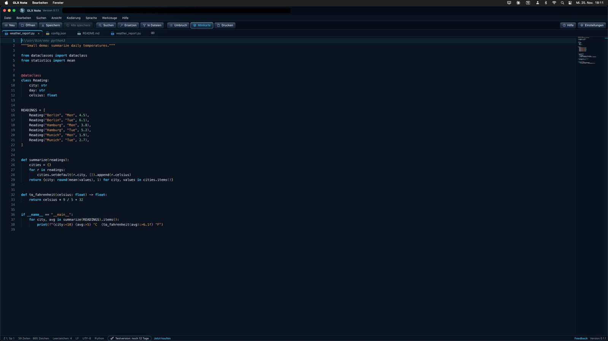
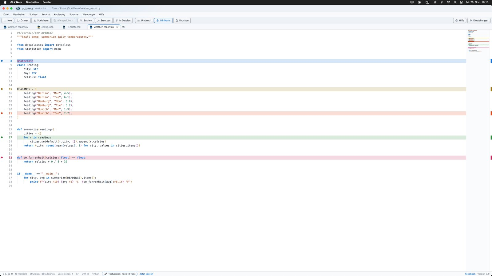
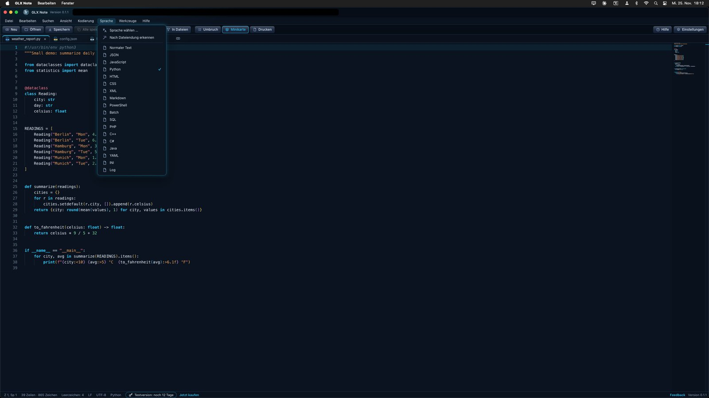
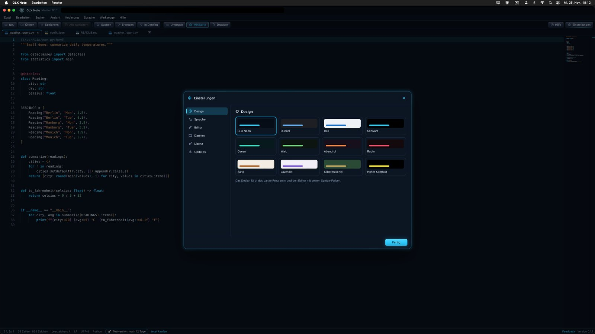
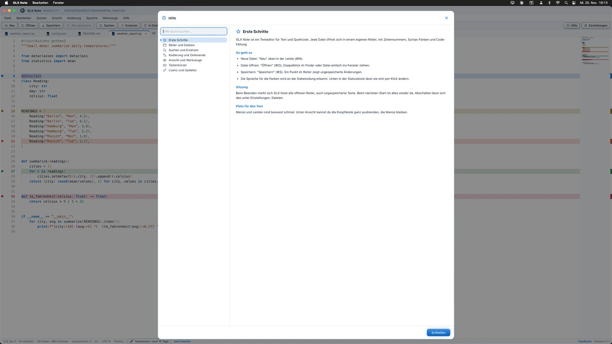

🌍 Sprachen: [🇺🇸 English](README.md) | [🇩🇪 Deutsch](README.de.md)

# 💠 GLX Note macOS

### Der schnelle Texteditor für den Mac.

*Syntax-Farben, Reiter und Suchen und Ersetzen auch in ganzen Ordnern.* ⚡

   

---

## ⬇️ Download

👉 Neueste Version: [Releases](../../releases/latest)  
👉 Shop und Lizenzen: [glx-tools.de](https://glx-tools.de/product/glx-note-macos/)

---

## 📖 Über GLX Note macOS

### Was ist GLX Note für macOS?

GLX Note ist ein Texteditor für Text und Quellcode im GLX-Design, gebaut auf dem Editor aus Visual Studio Code. Er läuft ab macOS 12 auf Intel-Macs und Macs mit Apple-Chip. Dateien öffnest du per Doppelklick, „Öffnen mit“ oder durch Ziehen aufs Dock.

### Syntax-Farben für über 80 Sprachen

Text, JSON, JavaScript, TypeScript, Python, HTML, CSS, XML, Markdown, Shell, SQL, PHP, C, C++, C#, Java, YAML, INI, Log-Dateien und viele mehr. Die Sprache wird an der Dateiendung erkannt und lässt sich mit einem Klick umstellen. Log-Dateien zeigen Fehler, Warnungen und Zeitstempel farbig.

### Reiter und Sitzung

Beliebig viele Dateien in Reitern, Umsortieren per Ziehen, Rechtsklick-Menü und Wiederöffnen versehentlich geschlossener Reiter. Beim nächsten Start sind alle Reiter wieder da, auch Texte, die du noch nie gespeichert hast.

### Suchen und Ersetzen

Im Dokument mit Groß-/Kleinschreibung, ganzen Wörtern und regulären Ausdrücken. In Dateien suchen und ersetzen durchsucht ganze Ordner mit Unterordnern und Dateifilter, die Treffer sind anklickbar. Vor dem Ersetzen sichert GLX Note jede Datei.

### Kodierungen wie bei Notepad++

UTF-8 mit und ohne BOM, UTF-16, ANSI, ISO-8859 und weitere werden beim Öffnen erkannt. Anzeigen als und Umwandeln in, Zeilenende Mac/Unix (LF) oder Windows (CRLF). Gespeichert wird sicher über eine Hilfsdatei, so geht die alte Datei nie kaputt.

### Komfort beim Schreiben

Zeilennummern, Codefaltung, Minikarte, Einrückungslinien, Klammerpaare, Mehrfach-Cursor und Spaltenauswahl, Lesezeichen, Gehe zu Zeile und Zoom mit Cmd+Mausrad. GLX Note merkt, wenn ein anderes Programm eine offene Datei ändert.

### Werkzeuge

JSON und XML formatieren oder verkleinern, Zeilen sortieren, doppelte und leere Zeilen entfernen, Groß- und Kleinschreibung, Base64 und URL kodieren, SHA-Prüfsummen, Text-Statistik, Markdown-Vorschau und Drucken mit Syntax-Farben.

### Im GLX-Stil

12 Designs, die auch die Syntax-Farben einfärben, Deutsch und Englisch, Hilfe im Programm mit Suche. Eigene Dateityp-Symbole für die gängigen Textformate.

### Installation

DMG öffnen und „GLX Note“ in den Ordner Programme ziehen. Einstellungen und Sitzung liegen unter ~/Library/Application Support/GLX Note.

### Testen und Lizenz

14 Tage mit allen Funktionen kostenlos testen. Danach lassen sich Dateien weiter öffnen und lesen, zum Bearbeiten und Speichern brauchst du die Lizenz.

---

## 📸 Überblick & Screenshots

### 1️⃣ Editor mit Syntax-Farben, Reitern und Minikarte

### 2️⃣ Farbige Lesezeichen im hellen Design

### 3️⃣ Sprache für die Syntax-Farben wählen

### 4️⃣ 12 Designs in den Einstellungen

### 5️⃣ Eingebaute Hilfe mit Suche

---

## ✨ Funktionen

- 🚀 **Syntax-Farben:** Farben für über 80 Sprachen.
- 🧩 **Reiter:** Viele Dateien nebeneinander offen.
- ⚙️ **Suchen und Ersetzen:** Auch in ganzen Ordnern.
- 🔒 **Kodierungen:** Alle gängigen Textkodierungen.
- 📂 **Sitzung:** Öffnet nach dem Neustart deine Dateien und Position wieder.
- ⚡ **Zwei Sprachen:** Deutsch und Englisch.

---

## 🧩 Systemanforderungen

- macOS 11 oder neuer

---

## 🧪 Testzeitraum & Lizenz

14 Tage kostenlos mit allen Funktionen, danach eine Lizenz über [glx-tools.de](https://glx-tools.de).

---

## 🔗 Mehr zu diesem Produkt

👉 [glx-tools.de](https://glx-tools.de/product/glx-note-macos/)  
Support: **info@glx-tools.de**

---

## 📄 Lizenz

Copyright © 2026 GLX Tools – Gordon Lehmann. Alle Rechte vorbehalten.  
Dies ist proprietäre kommerzielle Software. Es wird keine Open-Source-Lizenz gewährt. Dieses Repository enthält nur Release-Downloads und Dokumentation; der Quelltext wird nicht veröffentlicht.

---

Mit ❤️ gemacht von **Dreamdancer100**

